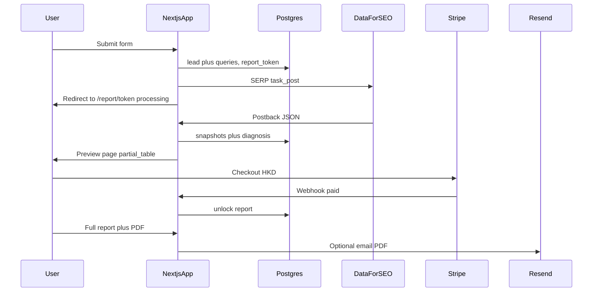

# Hong Kong GEO「點解唔推薦你」— Project Planning

Greenfield web app. The industry-leaders MVP uses **Google Search + Google AI Overviews** via **SerpAPI** ([ADR 0002](./adr/0002-serpapi-instead-of-dataforseo.md)). This file's later brand-diagnosis product keeps the same provider. Older sentences below that name DataForSEO describe the rejected queue-and-postback design. Delivery model for that later product: **web results page with a free teaser**, **full analysis and PDF behind Stripe Checkout (HKD)**.

Related doc: [POC.md](./POC.md) — DataForSEO proof-of-concept for AI visibility.

---

## Product

Public landing page in conversational Traditional Chinese (Hong Kong). A business submits brand, website, category, email, and optional competitors. We generate 6–8 HK-style recommendation queries, scrape Google HK SERPs (including AI Overviews), run diagnosis, then send the user to a **private report URL** (unguessable token).

### Free preview (partial_table)

Show enough to prove value, hide the actionable detail until payment:

| Shown free | Locked until paid |
|------------|-------------------|
| Overall **visibility score** (0–100 or similar) | Full **per-query table** (all 6–8 rows) |
| **Headline diagnosis buckets** (e.g. 「AIO 有，但冇點你名」) with 1–2 sentences each | **Competitor names** found in AIO / organic |
| **Sample queries**: first **2 of 8** with AIO yes/no + mention yes/no only | **Cited domains** list + frequency table |
| High-level counts: 「X/8 查詢有 AI 概覽」「Y/8 有提及品牌」 | **GEO action checklist** (5+ steps) |
| Disclaimer + scrape date | **PDF download** + optional **full report email** |

UI pattern: locked sections use blur/lock overlay + CTA 「解鎖完整報告 — HK$___」; do not leak locked fields in HTML/JSON (server returns `preview` vs `full` DTOs).

### Paid unlock

- **Stripe Checkout** (HKD, card + Apple Pay where enabled).
- One-time price per report (configure in Stripe; e.g. env `STRIPE_PRICE_ID` or `REPORT_PRICE_HKD` + dynamic `price_data`).
- On `checkout.session.completed` webhook: mark lead `paid`, grant access on same report URL (cookie or DB flag tied to `report_token`).
- After unlock: show full web report + **PDF download** button; optionally email PDF via Resend to address collected at checkout or form.

Every preview and full report must carry this disclaimer:

- Google AI Overviews **has no official API**. DataForSEO SERP is an unofficial scrape.
- Results **may not match** what a given Hong Kong user sees (personalization, device, timing).
- Snapshot only — not ChatGPT / Gemini.

ChatGPT LLM Scraper, Gemini scraper, and LLM Responses stay **out of v1** (phase 2).

---

## DataForSEO usage (v1)

Credentials from [https://app.dataforseo.com/api-access](https://app.dataforseo.com/api-access) stay **server-side only**. Use sandbox until pipeline is proven.

**Primary endpoint:** Standard Google Organic Advanced + postback:

- `POST /v3/serp/google/organic/task_post`
- `POST /v3/serp/google/organic/task_get/advanced/$id` (backup)
- Postback: `/api/dataforseo/postback`

Per-task: `location_code` HK (~`2344`), `language_code` `zh-TW`, `load_async_ai_overview: true`, `device: mobile`, `tag` = `lead_id`/`query_id`.

Cost ballpark: **6–8 queries ≈ $0.01–$0.02 per lead** (API) — price the HKD unlock above this + margin.

---

## Diagnosis engine (“點解唔推薦你”)

Rule-based from scrape evidence + Cantonese template copy (no LLM inventing reasons).

Per query: AIO present?, brand in AIO text?, brand domain in `references`?, organic rank, competitors/domains cited.

### Roll-up buckets (can stack)

| Bucket | Meaning |
|--------|---------|
| No AIO on these HK queries | No AI Overview on those SERPs — cannot diagnose “AI didn’t recommend you” on those searches |
| AIO exists, brand not named | AI box present but brand name not in AIO text |
| Named, but own site not cited | Brand in text but brand domain not in AIO `references` |
| Cited, but competitors dominate | Brand may appear but competitors win mentions + citations |
| Weak organic (not page 1) | Brand not on page 1 organically — often correlates with weak AIO presence |
| Citations cluster on third-party | References go to Wikipedia, OpenRice, price.com, news — not brand site |

**Preview DTO** exposes: score, bucket labels, aggregate counts, 2 sample query rows (boolean flags only).  
**Full DTO** adds: all queries, competitor table, cited-domain frequency, evidence snippets, checklist.

---

## Query generation

6–8 HK prompts: `香港{category}推薦`, `邊間{category}好`, `最好嘅{category}香港`, `{category}比較`, `best {category} Hong Kong`, `{brand} 好唔好`, optional competitor comparisons.

---

## Tech stack

- **Next.js App Router + TypeScript + Tailwind**
- **Postgres** (Supabase or Docker; server-only DB access for report data)
- **DataForSEO Standard + postback** + reconcile cron
- **Stripe**: Checkout Sessions + **webhook** (`/api/stripe/webhook`, verify signature)
- **@react-pdf/renderer** + Noto Sans TC (generate on unlock or pre-generate and gate download)
- **Resend** (post-unlock email optional)
- **Cloudflare Turnstile** on form
- Deploy **Vercel / Node host** (PDF + fonts)

Core env: `DATAFORSEO_*`, `DATABASE_URL`, `STRIPE_SECRET_KEY`, `STRIPE_WEBHOOK_SECRET`, `STRIPE_PRICE_ID` (or price config), `NEXT_PUBLIC_STRIPE_PUBLISHABLE_KEY`, `REPORT_UNLOCK_PRICE_HKD`, `RESEND_API_KEY`, `TURNSTILE_*`, `ADMIN_PASSWORD`, `POSTBACK_SECRET`, `APP_URL`.

### Suggested layout

- `src/lib/dataforseo/client.ts`
- `src/lib/queries/generate.ts`
- `src/lib/diagnosis/score.ts`
- `src/lib/report/preview.ts` — strip full DTO to partial_table preview
- `src/lib/stripe/checkout.ts` — create session with `client_reference_id` = lead id, metadata `report_token`
- `src/lib/pdf/Report.tsx`
- `src/app/page.tsx` — landing + form
- `src/app/report/[token]/page.tsx` — processing → preview or full
- `src/app/api/leads/route.ts`
- `src/app/api/reports/[token]/route.ts` — preview vs full based on `paid_at`
- `src/app/api/stripe/checkout/route.ts`
- `src/app/api/stripe/webhook/route.ts`
- `src/app/api/dataforseo/postback/route.ts`
- `src/app/api/cron/reconcile/route.ts`
- `src/app/admin/page.tsx` — leads, payment status, manual unlock

### Data model (minimal)

- `leads`: brand, domain, category, email, competitors, status (`queued|running|ready|failed`), **`report_token`**
- `lead_queries`: query text, language, dataforseo_task_id
- `serp_snapshots`: raw JSON, parsed fields
- `reports`: full `diagnosis_json`, `pdf_storage_key`
- **`payments`**: `lead_id`, Stripe ids, amount_hkd, status, **`paid_at`**

Access rule: `paid_at IS NOT NULL` OR admin override → full report + PDF.

---

## UX (v1 pages)

1. **Landing** — form; 「幾分鐘後睇初步結果；完整分析需解鎖」
2. **`/report/[token]`** — `processing` | `preview` | `unlocked`
3. **Stripe success** — `/report/[token]?unlocked=1`
4. **PDF** — only after unlock
5. **`/admin`** — payment status, resend PDF, force unlock

No user accounts for v1; **report token + payment** is access.

---

## Security notes

- Never expose full diagnosis or competitor/citation lists in preview API responses.
- Rate-limit report token lookups; Turnstile on form.
- Webhook idempotency for `checkout.session.completed`.

---

## Out of scope (phase 2)

- ChatGPT / Gemini scrapers, LLM Responses, LLM Mentions (ChatGPT mentions US/en only)
- Subscriptions, recurring monitoring
- Multi-tenant SaaS login

---

## Implementation order

| Step | Task |
|------|------|
| 0 | **Git** — `git init` on `main` (done); `.gitignore` with Next.js scaffold |
| 1 | Scaffold app, env, DataForSEO client, sandbox ping |
| 2 | Schema + form + Turnstile + `report_token` |
| 3 | SERP pipeline + postback + diagnosis |
| 4 | Preview vs full report page + API split |
| 5 | Stripe Checkout + webhook + unlock |
| 6 | PDF gated on unlock + optional Resend |
| 7 | Reconcile cron, admin overrides, disclaimer copy |

---

## Implementation todos

- [ ] Scaffold Next.js + env + DataForSEO Basic-auth client (sandbox first)
- [ ] Postgres schema (leads, queries, snapshots, reports, payments) + form with Turnstile
- [ ] Generate 6–8 HK queries, Standard SERP + postback, persist organic + AIO
- [ ] Rule-based mention/citation/organic scoring and diagnosis buckets
- [ ] Results page partial_table preview + Stripe HKD unlock + full view + PDF
- [ ] Reconcile cron, Stripe webhooks, admin, disclaimer copy
