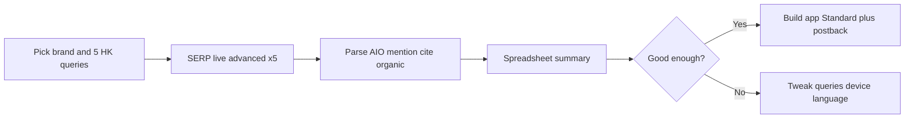

# DataForSEO POC — AI Visibility (Hong Kong)

Historical notes from the first provider trial. The product requirement is now SerpAPI: [ADR 0002](./adr/0002-serpapi-instead-of-dataforseo.md) and [MVP.md](./MVP.md).

Proof-of-concept guide for validating **Google AI Overviews (AIO)** visibility before building the full app. Aligns with [PLANNING.md](./PLANNING.md).

**AIO** = Google **AI Overviews** — the AI summary box at the top of Google search. There is **no official Google API** for it; DataForSEO returns scraped SERP JSON including an `ai_overview` item when present.

---

## 1. Setup

1. Get credentials at [https://app.dataforseo.com/api-access](https://app.dataforseo.com/api-access) (login + password for **Basic auth**).
2. **Sandbox** (test first): `https://sandbox.dataforseo.com/v3`  
   **Production**: `https://api.dataforseo.com/v3`
3. Verify account:

```bash
curl -u "LOGIN:PASSWORD" "https://sandbox.dataforseo.com/v3/appendix/user_data"
```

**Docs**

- [AI Optimization overview](https://docs.dataforseo.com/v3/ai_optimization/overview/)
- [Google Organic SERP Advanced (Live)](https://docs.dataforseo.com/v3/serp/google/organic/live/advanced/)
- [Scrape Google AI Overviews (help)](https://dataforseo.com/help-center/how-to-scrape-google-ai-overviews-with-serp-api)

---

## 2. Primary POC (matches v1 product)

**Goal:** For HK recommendation queries, answer:

- Is there an **AI Overview**?
- Is the **brand named** in AIO text?
- Is the **brand domain cited** in `references`?
- What is **organic rank** for the brand?

### Step A — Hong Kong location code

```bash
curl -u "LOGIN:PASSWORD" "https://api.dataforseo.com/v3/serp/google/locations/hk"
```

Use Hong Kong `location_code` from the response (commonly **2344** — always confirm).

**Language:** `zh-TW` (Traditional Chinese in DataForSEO; usually no `zh-HK`).

### Step B — Single query, Live Advanced (fastest feedback)

Live returns full AIO JSON in one request (~good for POC; higher $ than Standard queue).

```bash
curl -u "LOGIN:PASSWORD" -H "Content-Type: application/json" -X POST \
  "https://api.dataforseo.com/v3/serp/google/organic/live/advanced" \
  -d "[{
    \"keyword\": \"香港 會計師 推薦\",
    \"location_code\": 2344,
    \"language_code\": \"zh-TW\",
    \"device\": \"mobile\",
    \"load_async_ai_overview\": true
  }]"
```

### Step C — What to inspect in the response

| JSON location | POC question |
|---------------|--------------|
| `items[]` where `type === "ai_overview"` | Did Google show AIO? |
| `ai_overview.markdown` / nested `ai_overview_element` text | Brand **mentioned**? |
| `ai_overview.references[]` (`domain`, `url`, `source`) | Brand **domain cited**? Who else? |
| Organic items (`type === "organic"`) | Brand URL **rank**? |
| `asynchronous_ai_overview` on item | If AIO missing, was it async-only? (need `load_async_ai_overview: true`) |

### Step D — Query set (repeat 5–8 times)

Use real category + brand tests:

- `香港{category}推薦`
- `邊間{category}好`
- `最好嘅{category}香港`
- `{category}比較`
- `best {category} Hong Kong`
- `{brand} 好唔好`

Save each response JSON; fill a simple spreadsheet:

| Query | AIO? | Mention? | Cited? | Organic rank | Top cited domains |

### Step E — Production-like flow (same as the app)

**Standard** (cheaper at scale):

1. `POST /v3/serp/google/organic/task_post` — same body fields; optional `postback_url`, `tag`
2. `GET /v3/serp/google/organic/task_get/advanced/{task_id}` if no postback

---

## 3. POC pass/fail criteria

| Criterion | Pass |
|-----------|------|
| Parsing | You can reliably detect AIO / mention / citation / organic rank from JSON |
| Coverage | AIO appears on enough **recommendation** queries (not all queries have AIO — that’s normal) |
| HK fit | `zh-TW` + HK `location_code` returns sensible Traditional Chinese SERPs |
| Cost | ~6–8 Standard tasks + async AIO ≈ **$0.01–0.02** per “report” feels OK vs planned HKD price |
| Honesty | Manual Google HK check shows **some** mismatch (personalization) — disclaimers required |

---

## 4. Optional POCs (phase 2 / comparison)

### ChatGPT Search (what users see in ChatGPT UI)

**Not** the same as OpenAI API. Use **LLM Scraper**:

```bash
curl -u "LOGIN:PASSWORD" -H "Content-Type: application/json" -X POST \
  "https://api.dataforseo.com/v3/ai_optimization/chat_gpt/llm_scraper/live/advanced" \
  -d "[{
    \"keyword\": \"best accounting firm Hong Kong\",
    \"location_code\": 2344,
    \"language_code\": \"en\",
    \"force_web_search\": true
  }]"
```

Inspect: `markdown`, `sources[]`, `brand_entities[]`, `check_url`.

- [ChatGPT LLM Scraper overview](https://docs.dataforseo.com/v3/ai_optimization/chat_gpt/llm_scraper/overview/)
- [Scraper vs Responses](https://dataforseo.com/help-center/what-is-llm-scraper-api-and-what-data-does-it-provide)

### LLM Responses (programmatic model — ≠ ChatGPT website)

Use for controlled prompts (e.g. `web_search_country_iso_code: "HK"`), not for “exactly what client sees in ChatGPT app.”

### LLM Mentions (historical database)

`POST /v3/ai_optimization/llm_mentions/search_mentions/live`

- `platform: "google"` — useful for HK AIO-related history
- `platform: "chat_gpt"` — **US + English only** — poor for HK Traditional Chinese POC alone

Example (Google platform):

```json
[{
  "platform": "google",
  "location_code": 2344,
  "language_code": "zh-TW",
  "target": [{ "keyword": "品类或品牌词", "search_scope": ["answer"] }],
  "limit": 10
}]
```

Pricing: ~$0.10 per task + $0.001 per row ([LLM Mentions pricing](https://dataforseo.com/pricing/ai-optimization/llm-mentions)).

---

## 5. Suggested 1–2 hour workflow



1. One real HK brand + category + 2 competitor names.  
2. Five **Live Advanced** calls (mobile, `zh-TW`, `load_async_ai_overview: true`).  
3. Compare one query manually in Google HK (logged out / incognito).  
4. Optional: one **ChatGPT Scraper** call for contrast.  
5. Set Stripe unlock price from API cost × margin.

---

## 6. Pitfalls

| Issue | Note |
|-------|------|
| No AIO | Many queries never trigger AIO — use recommendation-style keywords |
| `ai_overview: null` | Set `load_async_ai_overview: true` for async AIO |
| Language | Use `zh-TW`, not `zh-HK` |
| ChatGPT Mentions for HK | `chat_gpt` platform is US/en only |
| LLM Responses | API answer ≠ ChatGPT web UI — label clearly if shown |
| No official AIO API | DataForSEO SERP is third-party scrape — disclose in product |

---

## 7. Pricing references

- [Google Organic SERP](https://dataforseo.com/pricing/serp/google-organic)
- [LLM Scraper](https://dataforseo.com/pricing/ai-optimization/llm-scraper) — from ~$0.0012/result (Standard) to $0.004 (Live)
- [LLM Mentions](https://dataforseo.com/pricing/ai-optimization/llm-mentions)
- [LLM Responses](https://dataforseo.com/pricing/ai-optimization/llm-responses)

---

## 8. Terminology (for reports)

| Term | Meaning |
|------|---------|
| **AIO** | Google AI Overviews block in SERP |
| **Mentioned** | Brand name appears in AIO text |
| **Cited** | Brand **website** appears in AIO `references` |
| **Organic rank** | Position in normal blue links below AIO |

A brand can be mentioned but not cited, cited but not mentioned, or absent from both.
